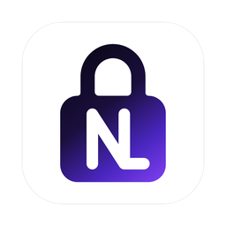

  

<h1 align="center">NotchLock</h1>

Your study plan, timer, music and calendar, living in your MacBook's notch. 
Hover over the notch (or press ⌥⌘N) and it drops down. Move away and it tucks back in.

  <a href="https://github.com/NotchLock/NotchLock/releases/latest/download/NotchLock.zip"><b>Download NotchLock</b></a>
  &nbsp;·&nbsp;
  <a href="https://notchlock.com">Website</a>
  &nbsp;·&nbsp;
  <a href="mailto:notchlockapp@gmail.com">Support</a>

---

## Contents

- [Install](#install)
- [Free and Pro](#free-and-pro)
- [The notch](#the-notch)
- [Music and video](#music-and-video)
- [Calendar](#calendar)
- [Timer, Pomodoro and stopwatch](#timer-pomodoro-and-stopwatch)
- [Study button and stats](#study-button-and-stats-pro)
- [Study planner](#study-planner-pro)
- [Distraction blocking](#distraction-blocking-pro)
- [Quick add shortcuts](#quick-add-shortcuts-pro)
- [Files, AirDrop and Share](#files-airdrop-and-share)
- [Keyboard shortcuts](#keyboard-shortcuts)
- [Little things you might not notice](#little-things-you-might-not-notice)
- [Permissions and why they're needed](#permissions-and-why-theyre-needed)
- [Updates](#updates)
- [Privacy](#privacy)
- [Uninstalling](#uninstalling)
- [Help](#help)

---

## Install

1. [Download NotchLock.zip](https://github.com/NotchLock/NotchLock/releases/latest/download/NotchLock.zip) and open it.
2. Drag **NotchLock** into your **Applications** folder and open it.
3. A welcome window walks you through the permissions. Every step is optional, and you can come back to it any time from Settings → About.

NotchLock needs **macOS 14 (Sonoma) or later**. It's made for MacBooks with a notch, but works on any Mac: on screens without one (an older MacBook or an external monitor) it draws a notch at the top of the screen.

It has no Dock icon. You'll find it in the menu bar, and in the notch itself. The app is signed and notarised by Apple, so it opens normally.

## Free and Pro

Most of NotchLock is free, for as long as you like. Pro adds the study tools. Every new install gets a **14-day free trial of Pro**, with no card needed.

| | Free | Pro |
|---|:---:|:---:|
| Music controls (Spotify, Apple Music, any audio or browser video) | ✓ | ✓ |
| Calendar list and timeline, with Join buttons for calls | ✓ | ✓ |
| Timer, Pomodoro, stopwatch, full-screen timer, lock-screen timer | ✓ | ✓ |
| Files shelf, AirDrop and Share | ✓ | ✓ |
| Study stats, streaks and history | | ✓ |
| Study planner with Plan my week and exam countdowns | | ✓ |
| Distraction blocking and Do Not Disturb | | ✓ |
| Reminder and calendar quick add shortcuts | | ✓ |

**NotchLock Pro is US$12 a year.** One key works on 2 Macs. Get it at [notchlock.com](https://notchlock.com), then paste the key into Settings → About (or on the welcome screen). To move your key to another Mac, uninstall NotchLock from Settings → Advanced and the key is freed automatically.

---

## The notch

**Opening it.** Hover over the notch, click it (if you turn on *Open with a click instead of hovering*), or press **⌥⌘N** from anywhere. Click anywhere outside it, or move the pointer away, and it closes.

**The open notch** has three parts:

- **Left:** what's playing: song, podcast or video.
- **Right:** your calendar, or your study stats. Switch between them with the toggle at the top left.
- **Bottom:** the timer.

Along the top, either side of the camera, are buttons for Files and Settings.

**The closed notch** still shows what's happening, in small "ears" either side of the camera:

- Album art on the left and moving sound bars on the right while music plays
- The running timer, with or without seconds
- Your current study block and how many minutes are left in it
- A countdown to your next event, starting 15 minutes before it begins (you can change how early)
- A thin progress line along the bottom edge for the current study block

You can switch each of these on or off in Settings → Appearance. The ears are always the same width on both sides, so the notch stays centred on the camera.

**Make it your own** (Settings → Appearance):

- **Size:** make the open notch 80% to 130% of its normal size. At the smallest size, the top buttons switch to icons only, so nothing slides under the camera.
- **Shade:** pure black by default, the darkest your screen can show. You can lift it to a dark grey.
- **Album colour:** tint the open notch with the colours of the album art or the video's site.
- **Let notch sit on screen:** on screens without a real notch, keep the notch visible all the time, not just when you hover.

**Opening and closing** (Settings → General): change the hover delay (0 to 0.6 seconds) and the close delay, turn on haptic feedback on the trackpad when the notch opens, use 24-hour time, and choose whether NotchLock shows on external displays.

---

## Music and video

**Spotify.** Artwork, song, artist, a scrub bar you can drag, and play, pause, previous and next. This works with the Spotify app and doesn't need an account, or even the internet. If nothing is playing, pressing play opens Spotify and starts your last song.

- **Like and add to playlist (optional):** connect your Spotify account in Settings → Audio to get a heart button (saves to Liked Songs) and a button that adds the current song to a playlist you choose.

**Apple Music.** Pick Apple Music in Settings → Audio and it shows and controls Apple Music instead.

**All audio.** With *Notch shows: All audio*, NotchLock shows whatever your Mac is playing, the same as Control Center: podcasts, audiobooks, other music apps, and video in your browser. Choose *Just music* if you only want music apps.

**Browser video.** When a video plays in Safari, Chrome, Brave or Edge, the left side shows it, coloured for the site, with the browser's icon as a badge. It knows YouTube, Netflix, Disney+, Prime Video, Apple TV+, Max, Paramount+, Twitch, Vimeo and Crunchyroll, plus Australian services: Stan, Binge, Kayo, ABC iview, SBS On Demand, 7plus, 9Now and 10 Play. Other sites still work and show the site's name. A **Show the tab** button jumps straight to the tab that's playing.

> To control browser audio, NotchLock needs Accessibility permission. After you allow it, press **Restart NotchLock** in Settings → Audio, because macOS sometimes only applies it after a restart.

---

## Calendar

**Apple Calendar or Google Calendar.** Use the calendars already on your Mac (iCloud, Exchange, Google accounts added to macOS), or sign in to Google Calendar directly in Settings → Calendar if you haven't added it to your Mac. Google access is read-only.

**List or timeline.** See the day as a list, or as a timeline from midnight to midnight with a red line for right now. Overlapping events sit side by side, and all-day or multi-day events (like a trip) show as a thin line along the top. Hover over anything on the timeline to see what it is. Arrows let you flick to the next or previous day.

**Join buttons.** If an event has a Zoom, Teams, Google Meet, Webex or FaceTime link, a **Join** button lights up from 10 minutes before until the meeting ends.

**Choose what shows:** turn individual calendars on or off, show or hide all-day events, and hide events you've declined.

---

## Timer, Pomodoro and stopwatch

The timer runs along the bottom of the open notch.

- **Timer:** tap a preset or type a custom time in hours and minutes. You can change the presets in Settings → Timer.
- **Pomodoro:** 25 minutes focus, 5 minute break, and a 15 minute long break every 4 rounds. You can change all of these, and turn on *Start the next round automatically*. The notch shows which round you're up to, like "Focus 2/4".
- **Stopwatch:** counts up.
- **Count down to the end of this block:** one tap sets a timer that ends exactly when your current study block does.

**Full-screen timer.** Click the hourglass on the timer bar for a big timer with a progress ring that fills the whole screen. Turn on *Open full screen when a timer starts* to always get it. Press Esc to leave.

**Lock-screen timer.** With *Show the timer on the lock screen* on, your timer stays visible when you lock your Mac, and the display stays awake while it runs. So you can lock your laptop, walk away, and still see the time from across the room.

**Alarms.** Choose the alarm sound, how long it rings (once, or up to 5 minutes), and whether your music pauses when it rings. There's also a separate chime for when a timer or study block ends, and optional alerts when a study block starts or ends.

Every timer, Pomodoro round and stopwatch session is added to your study stats automatically.

---

## Study button and stats (Pro)

**The Study button** counts how long you study in the background, with no timer running. Press it to start and again to stop, and the time goes into your stats. It keeps counting even if you restart your Mac. If your calendar shows a subject at the time, the session is filed under that subject.

**Stats in the notch.** Switch the right side to Stats to see your streak, today's time, this week's time and a 7-day chart.

**Full stats** are in Settings → Study:

- **Overview:** your streak (it glows while it's alive), time today, this week, and the number of timers, Pomodoros, stopwatch and Study sessions.
- **Activity:** bars for the last 7 days, with a dashed line at your daily average.
- **Subjects:** hours this week for each subject, and progress towards each subject's exam goal ("6h of 10h · exam in 4 days").
- **History:** a month calendar with a dot on every day you studied. Pick a day to see exactly what you did.
- **Add a time studied** by hand, for study you did away from your Mac.

---

## Study planner (Pro)

Settings → Planner builds your study timetable for you.

**Add your subjects.** For each one, set how hard it is (easy, medium, hard), how much content there is (small, medium, large), and an optional exam date. NotchLock estimates how many hours you need, from about 3 hours for small and easy up to about 12 for large and hard. You can change the estimate. Each subject gets its own colour, which you can change, and an urgency tag (high, medium, low) that's set from the exam date unless you set it yourself.

**Scan your calendar for exams.** NotchLock looks for events named like exams, tests, assessments, quizzes, assignments, essays, pracs, trials and HSC. If an exam is named after one of your subjects ("Physics exam"), it's added to that subject. If it doesn't match a subject, a new subject is made for it. You can ignore any you don't want.

**Plan my week.** One button works out how much of each goal is left and spreads it over the days until each exam, with a bit more the day before. Subjects without an exam get light revision. It fits everything into the free time in your calendar, inside your study hours, around lunch and dinner, with breaks and a daily limit.

**See it and change it.** The plan shows as a week grid, with your existing events greyed out behind it. Drag a block to move it, drag its bottom edge to make it longer or shorter (it snaps to 15 minutes), or click it to change the time or remove it. Urgent blocks get a 🔥.

**Add to calendar.** When you're happy with it, the plan goes into your calendar, along with lunch and dinner if you want. It then shows on the notch's timeline, and the notch knows what you're meant to be studying right now.

**Preferences, if you want them:** study hours for weekdays and weekends, block length, short and long breaks, how many blocks before a long break, a daily limit (3 hours by default), lunch and dinner times, and how many days to plan. Leave any part off and NotchLock uses sensible defaults.

**Upcoming exams** shows a countdown to each exam. An exam counts as finished 3 hours after it starts.

---

## Distraction blocking (Pro)

Turn on *Block distractions while timer is running* (or *while studying*, for the Study button) in Settings → Timer. While you focus, NotchLock **hides** chat, game and streaming apps the moment they come to the front: Discord, Messages, FaceTime, WhatsApp, Telegram, Messenger, Steam, Epic Games, Battle.net, Roblox, Minecraft, Lunar Client, the TV app, Netflix and Apple Arcade.

- Apps are hidden, not quit, so you never lose anything.
- Pomodoro breaks don't count, so you can reply to messages on your break.
- **Do Not Disturb:** hiding an app doesn't stop its notifications. In Settings → Timer, click **Add Focus On** and **Add Focus Off**, then **Add Shortcut** in each. NotchLock can then switch Do Not Disturb on while you focus and off when you're done. (macOS doesn't let apps change Focus directly, so this uses two small Shortcuts.) If NotchLock quits mid-session, it turns Do Not Disturb back off.

---

## Quick add shortcuts (Pro)

**Reminder quick add (⌥⌘T).** Press it anywhere, type a task, press Return. It's saved to Apple Reminders, so it syncs to your iPhone. Words like "tomorrow", "tmrw", "friday", "tonight" or "3pm" set the due date, like *ask teacher about Q4 tomorrow*.

**Calendar quick add (⌥⌘E).** Type an event like *Dentist friday 3pm* and press Return. With Apple Calendar it's added straight away. With Google Calendar, Google Calendar opens in your browser with the event filled in, ready to save. It understands days, dates, months, times and ranges like *saturday to monday*.

Turn either on and change the keys in Settings → Shortcuts.

---

## Files, AirDrop and Share

**The shelf.** Drag files onto the notch and they wait on the shelf until you drag them out somewhere else. It's handy for moving files between apps, desktops or full-screen windows. Start dragging a file towards the notch and it opens by itself, a little before you reach it. Dropping a file on the open notch jumps to the Files page.

It works with more than files: photos from Photos, Mail attachments and images from web pages work too.

**Send box.** Drop files on the left half to **AirDrop** them, or the right half to open the **Share** menu (Messages, Mail, Notes and more). The shelf also has **AirDrop all** and **Share all** buttons. Press Esc to close either popup. If AirDrop can't send because Wi-Fi or Bluetooth is off, NotchLock tells you instead of doing nothing.

Open the Files page from the folder icon at the top of the notch, or from the menu bar icon.

---

## Keyboard shortcuts

| Shortcut | What it does |
|---|---|
| **⌥⌘N** | Open or close the notch |
| **⌥⌘T** | Reminder quick add (Pro) |
| **⌥⌘E** | Calendar quick add (Pro) |
| **Esc** | Leave the full-screen timer, stop a ringing alarm, close AirDrop or Share |

You can change all three shortcuts in Settings → Shortcuts. They don't need any extra permission.

---

## Little things you might not notice

- **The notch opens with a small spring and closes cleanly.** Every button presses in a little and springs back.
- **Uneven notch?** If one side shows more than the other, the notch shifts so it still lines up with the camera.
- **It works over full-screen apps and on every desktop (Space).**
- **Typing a custom time** briefly takes the keyboard. When you're done, NotchLock hands it back to the app you were in.
- **The scrub bar moves smoothly** between updates, and album art is retried every 15 seconds if it doesn't load the first time.
- **Podcasts, ads and local files in Spotify** don't break the display.
- **The last player you used wins.** If Spotify and a YouTube video are both open, the notch shows whichever you played most recently.
- **The Study button taps the trackpad** to confirm when you finish a session.
- **Long calendar events** (10 hours or more, like "Term 4" or "Exam period") are ignored by the planner, so they don't block whole days.
- **Calendar events named after a subject** count as study blocks, even ones you made yourself, so the notch shows them with minutes left.
- **Study or Work wording.** Choose what you use NotchLock for in Settings → General. *Work* changes the words throughout: Study becomes Lock In, subjects become projects, exams become deadlines, and the exam scan looks for words like "deadline", "launch" and "submission" instead.
- **The menu bar icon** shows your trial days left, and has shortcuts to open the notch, Files, Settings and updates. You can hide it in Settings → General.
- **Reset settings** (Settings → General) puts the look and behaviour back to default but keeps your stats, subjects and connections.
- **Reset all permissions** (Settings → Advanced) fixes most "it looks switched on but doesn't work" problems. It clears every permission and restarts NotchLock so macOS asks again.

---

## Permissions and why they're needed

Everything is optional. Skip what you don't use.

| Permission | Used for |
|---|---|
| **Automation → Spotify / Music** | Reading and controlling the song |
| **Automation → your browser** | Reading and controlling browser videos (a backup to Accessibility) |
| **Accessibility** | Media keys for browser audio and other apps |
| **Calendars** | Showing your events, scanning for exams, adding your plan and quick-add events |
| **Reminders** | Reminder quick add |
| **Shortcuts** (two you add) | Turning Do Not Disturb on and off while you focus |

If something stops working, use **Settings → Advanced → Reset all permissions**.

---

## Updates

NotchLock checks this page for a new version shortly after it opens and once a day. When there is one, an **Update to version X** button appears in Settings → About and in the menu bar. One click downloads it, checks it's genuinely signed by NotchLock, swaps it in and relaunches. Your settings, stats, trial, key and permissions are all kept.

You can turn off *Check automatically* in Settings → About, or press **Check for Updates** any time. You can always download the latest version from the link at the top of this page.

---

## Privacy

Your study sessions, subjects, plan and settings are stored on your Mac only. Spotify and Google sign-ins are kept in your Mac's Keychain. Calendar and Reminders data is read on your Mac and never sent anywhere. NotchLock only goes online to check for updates, to check your Pro key, and for Spotify and Google if you connect them.

Full details: [Privacy](https://notchlock.com/#privacy) · [Terms](https://notchlock.com/#terms) · [Refunds](https://notchlock.com/#refunds)

## Uninstalling

Settings → Advanced → **Uninstall NotchLock completely** removes your settings, study history, subjects, planner, the files on the shelf and NotchLock's permissions. It also frees your Pro key from this Mac, so you can use it on another one. Then NotchLock moves itself to the Bin and quits.

## Help

Email **[notchlockapp@gmail.com](mailto:notchlockapp@gmail.com)**. Screenshots help a lot.

This repository holds NotchLock's releases. The app's source code isn't public.

